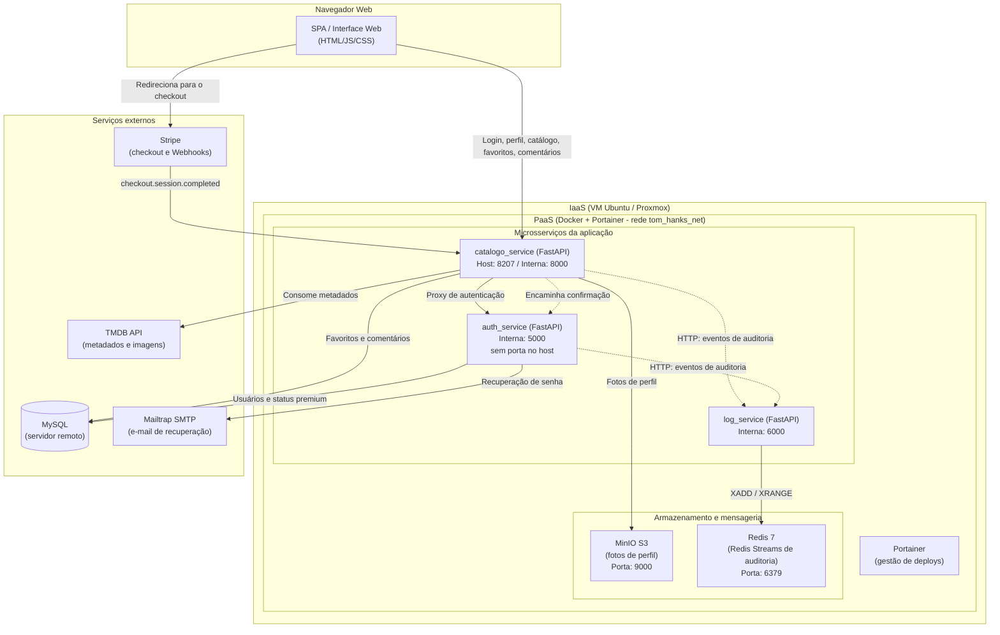
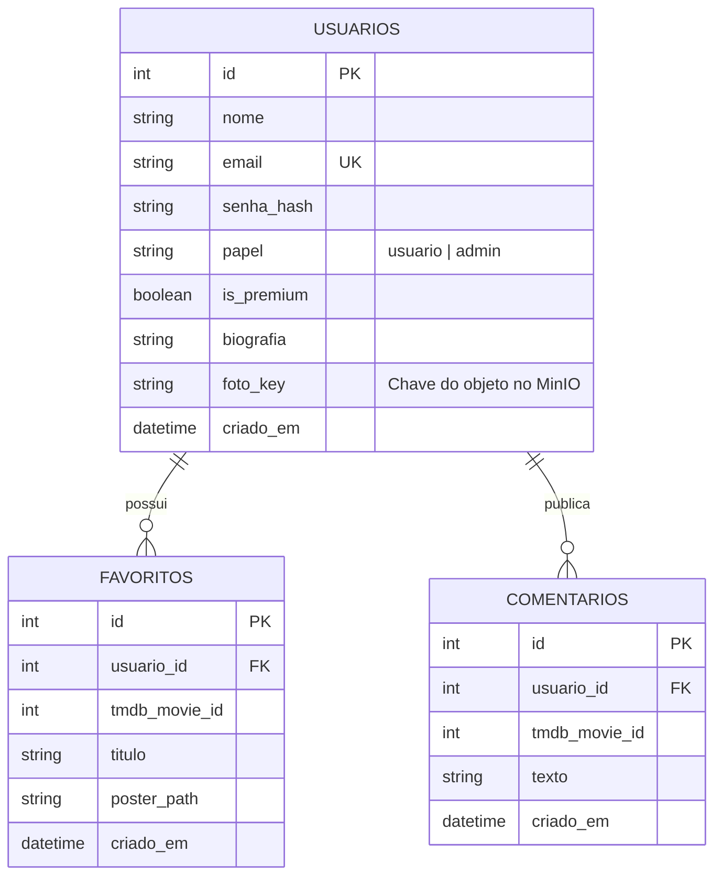

# 📚 Documentação Técnica Reversa do Sistema

Documento integrante da **Atividade 8** da disciplina de Introdução à Computação em Nuvem (ISW055), sob orientação do professor [siriani](https://github.com/siriani).

[← Voltar ao README](./README.md)

---

## 1. Especificação Funcional (O Que o Sistema Faz)

A aplicação é uma plataforma web de catálogo cinematográfico temático (filmografia de Tom Hanks), construída sobre uma arquitetura de microsserviços:

- **Autenticação e sessões:** cadastro de usuários, login com senha protegida por hash (Bcrypt) e emissão de tokens JWT (PyJWT). Inclui recuperação e redefinição de senha, com token temporizado enviado por e-mail via SMTP (Mailtrap).
- **Catálogo de filmes:** consulta em tempo real à API do TMDB, exibindo listagens, cartazes e sinopses. Nenhum dado do catálogo é persistido no banco.
- **Favoritos e níveis de serviço:**
  - Contas comuns (Free Tier) podem favoritar até 3 filmes.
  - Assinantes Premium têm favoritos ilimitados.
- **Comentários e moderação:** usuários autenticados publicam comentários nos filmes e apagam os próprios. Apenas administradores apagam comentários de terceiros.
- **Perfil de usuário e armazenamento de objetos:** visualização e alteração da biografia e envio de foto de perfil. As imagens ficam no MinIO e são entregues por um endpoint controlado da API, sem acesso público ao bucket.
- **Plano Premium (monetização):** checkout da Stripe em modo de teste. Após o pagamento, o status `is_premium` é atualizado e o privilégio passa a constar no JWT.
- **Auditoria e logs:** eventos críticos (logins, falhas de autenticação, favoritos, alterações de perfil e acessos negados) são enviados ao `log_service`, que os registra em Redis Streams. A consulta aos logs é restrita a administradores.
- **Observabilidade:** endpoints `/health` (readiness real) e `/metrics` (Prometheus) em cada serviço.

---

## 2. Tecnologias Utilizadas

| Camada | Tecnologia |
|--------|------------|
| Serviços de back-end | Python 3.11, FastAPI, Pydantic |
| Autenticação | Bcrypt (hash de senha), PyJWT (HS256) |
| Banco de dados relacional | MySQL |
| Logs de auditoria | Redis 7 (Redis Streams) |
| Armazenamento de objetos | MinIO (compatível com S3) |
| E-mail transacional | SMTP via Mailtrap (sandbox) |
| Contêineres e deploy | Docker, Docker Compose, Portainer |
| CI/CD | GitHub Actions, GitHub Container Registry (`ghcr.io`) |
| Testes | pytest |
| Métricas | `prometheus-fastapi-instrumentator` |
| Infraestrutura | VM Ubuntu Server sobre Proxmox |
| Serviços externos | TMDB API, Stripe (modo de teste) |
| Front-end | SPA em HTML, CSS e JavaScript, servida pelo `catalogo_service` |

---

## 3. Arquitetura do Sistema

O diagrama abaixo descreve a comunicação entre o cliente web, os microsserviços e as dependências externas. Apenas o `catalogo_service` é exposto ao host (porta `8207`). Os demais serviços ficam isolados na rede interna `tom_hanks_net`.



> **Classificação em camadas de nuvem:** a VM no Proxmox é a camada **IaaS**. Os contêineres Docker gerenciados pelo Portainer formam a camada de plataforma (**PaaS**), onde o deploy acontece por stack, sem reconfigurar o sistema operacional a cada ciclo. Stripe, TMDB e Mailtrap são **SaaS**, consumidos por API ou SMTP. A classificação completa está no [README](./README.md#atividade-8---classificação-saas-paas-e-iaas-do-projeto).

---

## 4. Catálogo de Regras de Negócio

As regras abaixo foram extraídas da análise do código-fonte.

| ID | Regra | Resultado |
|----|-------|-----------|
| **RN01** | **Limite de favoritos gratuito:** se `is_premium = False`, o usuário pode favoritar no máximo 3 filmes. | Ao incluir o 4º item, a API responde HTTP `403 Forbidden`. |
| **RN02** | **Favoritos ilimitados para Premium:** se `is_premium = True` (confirmado no JWT), a verificação de quantidade máxima é ignorada. | Adições ilimitadas. |
| **RN03** | **Isolamento de edição de perfil:** se o `usuario_id` do token for diferente do perfil alvo, a alteração de biografia ou foto é bloqueada. | HTTP `403 Forbidden` e evento de violação enviado à auditoria. |
| **RN04** | **Moderação restrita a administradores (RBAC):** apenas o papel `admin` apaga comentários de terceiros e consulta `/api/admin/logs`. | HTTP `403 Forbidden` para os demais, com tentativa registrada no log. |
| **RN05** | **Comentários próprios:** qualquer usuário autenticado apaga o próprio comentário (`comentario.usuario_id == usuario autenticado`). | Exclusão permitida; caso contrário, aplica-se a RN04. |
| **RN06** | **Segregação de dados por usuário:** consultas de favoritos são filtradas pelo `usuario_id` do token. | Um usuário nunca visualiza nem altera favoritos de outro. |
| **RN07** | **Validação de upload (MinIO):** a foto de perfil deve ser `image/jpeg`, `image/png` ou `image/webp` e ter no máximo 2 MB. | Caso contrário, HTTP `400 Bad Request`, antes do envio ao bucket. |
| **RN08** | **Expiração da recuperação de senha:** o token de redefinição vale por 30 minutos. | Após esse prazo, a alteração é abortada com HTTP `400 Bad Request`. |

---

## 5. Modelagem de Dados

Usuários, favoritos e comentários ficam em tabelas relacionais. Os eventos de auditoria **não** são tabelas: são entradas em Redis Streams. As fotos de perfil ficam no MinIO, e o banco guarda só a chave do objeto.



### Relacionamentos

- **USUARIOS → FAVORITOS (1:N):** um usuário pode ter vários favoritos, e cada favorito pertence a exatamente um usuário por meio de `usuario_id`.
- **USUARIOS → COMENTARIOS (1:N):** um usuário pode publicar vários comentários. A exclusão de comentários de terceiros é restrita ao papel `admin` (RN04).
- **USUARIOS → MinIO (1:1 lógico):** a foto de perfil não é guardada como BLOB no banco. Armazena-se apenas a referência (`foto_key`), separando os metadados dos binários pesados.
- **USUARIOS → Auditoria (1:N lógico):** cada evento no Redis Streams carrega o identificador do autor da ação, o que garante rastreabilidade sem uma tabela relacional.

### Eventos de auditoria (Redis Streams)

Gravados com `XADD` pelo `log_service` e lidos com `XRANGE` na rota `/api/admin/logs`. Registram logins, falhas de autenticação, operações com favoritos, alterações de perfil e tentativas de acesso negadas.

---

## 6. Observabilidade

| Serviço | `/health` | `/metrics` |
|---------|-----------|------------|
| `catalogo_service` | `SELECT 1` no banco (`200` ou `503`) | Prometheus |
| `auth_service` | `SELECT 1` no banco (`200` ou `503`) | Prometheus |
| `log_service` | `r.ping()` no Redis (`200` ou `503`) | Prometheus |

Os healthchecks do Docker Compose rodam a cada 10 segundos, com timeout de 5 segundos, e o daemon marca o contêiner como `unhealthy` quando a verificação falha.

---

## 7. Como Executar

```bash
# 1. Clonar o repositório
git clone https://github.com/Gabriel33-fis/catalogo-tom-hanks.git
cd catalogo-tom-hanks

# 2. Criar o arquivo de variáveis de ambiente a partir do modelo
cp .env.example .env
# edite o .env com as suas credenciais

# 3. Subir os serviços
docker compose up -d --build
```

A aplicação fica disponível na porta `8207` do host. Em produção, os segredos são definidos no painel *Environment variables* da stack no Portainer.

### Variáveis de ambiente

| Variável | Serviço | Descrição |
|----------|---------|-----------|
| `DB_HOST`, `DB_PORT`, `DB_USER`, `DB_PASSWORD`, `DB_NAME` | auth, catalogo | Conexão com o MySQL |
| `JWT_SECRET` | auth, catalogo, log | Chave de assinatura e validação dos JWT |
| `TMDB_API_KEY` | catalogo | Chave da API do TMDB |
| `AUTH_SERVICE_URL` | catalogo | Endereço interno do `auth_service` |
| `LOG_SERVICE_URL` | auth, catalogo | Endereço interno do `log_service` |
| `BASE_PUBLIC_URL` | auth | URL pública usada nos links de recuperação de senha |
| `MAILTRAP_HOST`, `MAILTRAP_PORT`, `MAILTRAP_USER`, `MAILTRAP_PASS` | auth | Credenciais SMTP |
| `REDIS_HOST`, `REDIS_PORT` | log | Conexão com o Redis |

---

## 8. Principais Endpoints

A lista completa, com códigos de erro, está no [README](./README.md#atividade-extra-1---documentação-de-apis-com-openapi-e-swagger). A documentação interativa fica em [`/docs`](https://gabriel-graciano-isw055.lapps.studio/docs).

| Grupo | Rotas |
|-------|-------|
| Autenticação | `/api/auth/register`, `/api/auth/login`, `/api/auth/logout`, `/api/auth/forgot-password`, `/api/auth/reset-password` |
| Catálogo | `/api/filmes` |
| Favoritos | `/api/favoritos`, `/api/favoritos/{id}` |
| Comentários | `/api/comentarios/{tmdb_id}`, `/api/comentarios`, `/api/comentarios/{id}` |
| Perfil | `/api/perfil/foto/{object_name}` |
| Administração | `/api/admin/logs` |