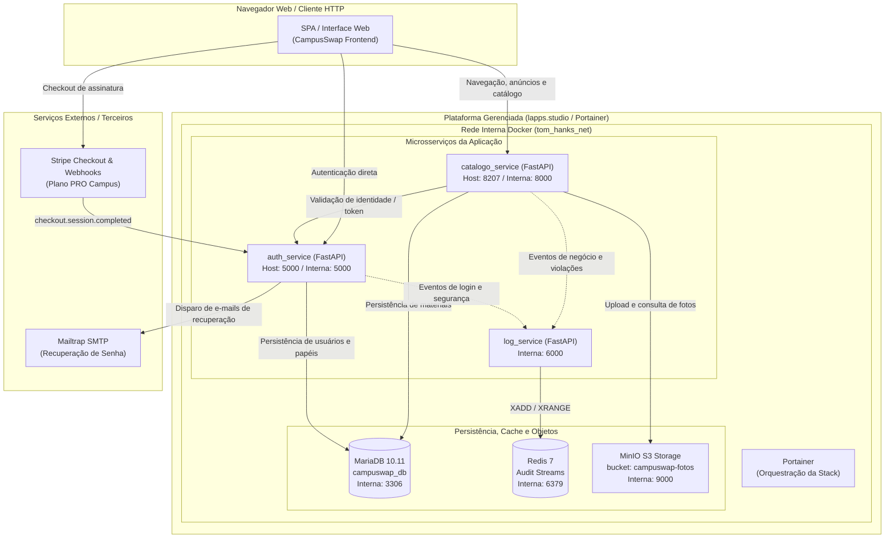
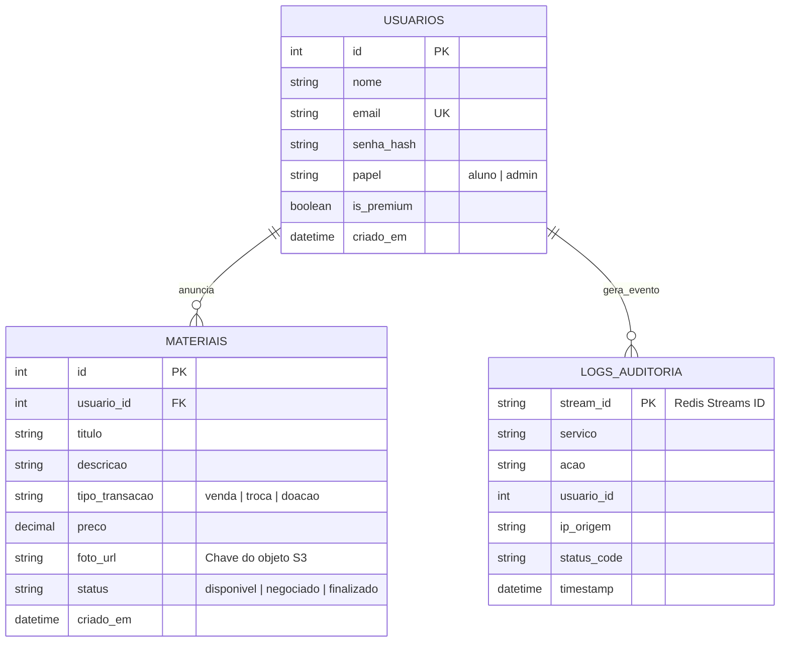
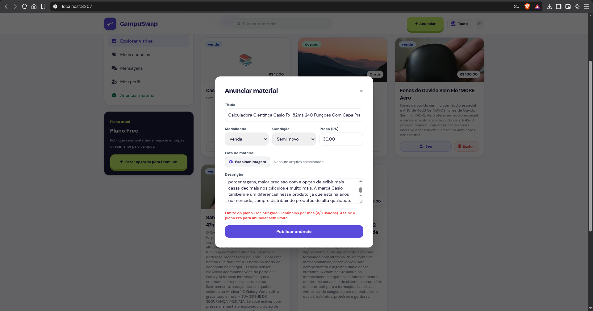
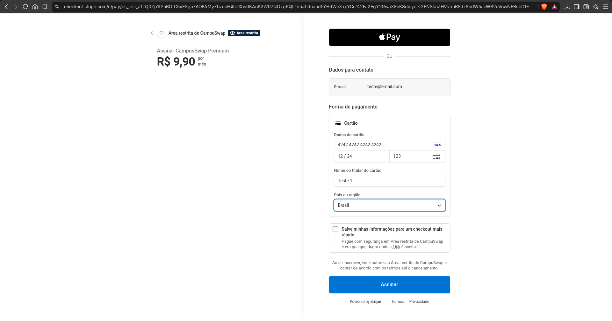
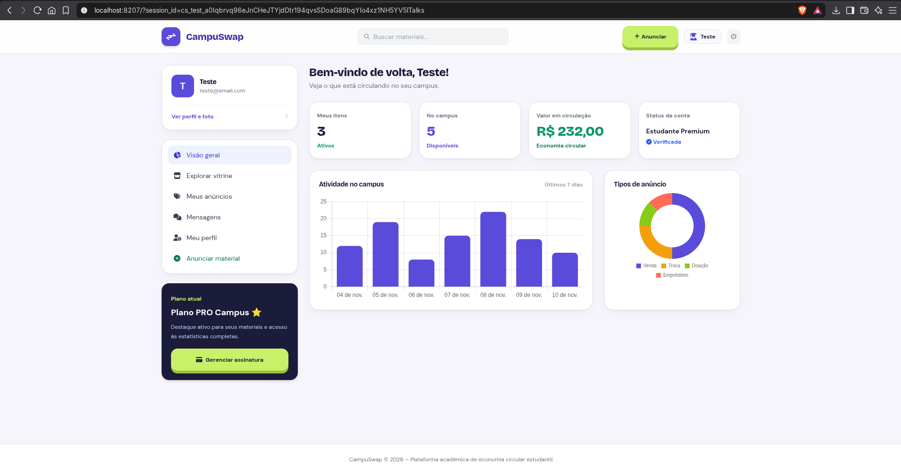
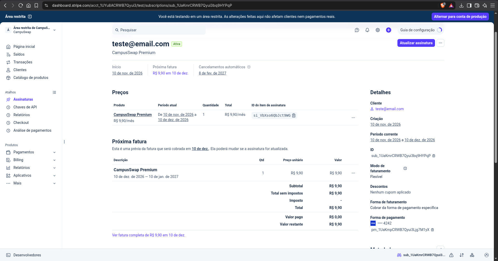
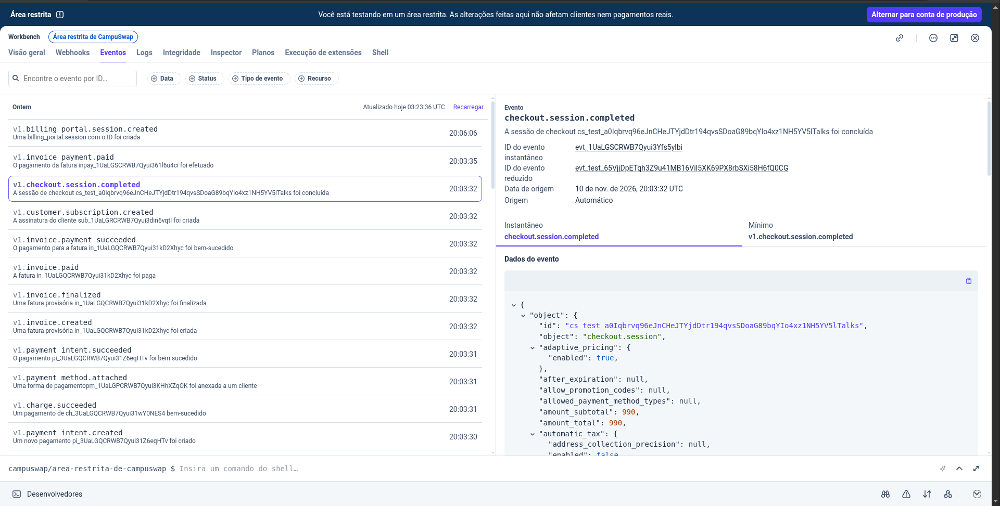
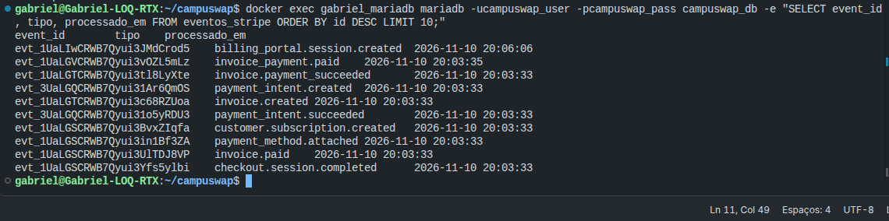
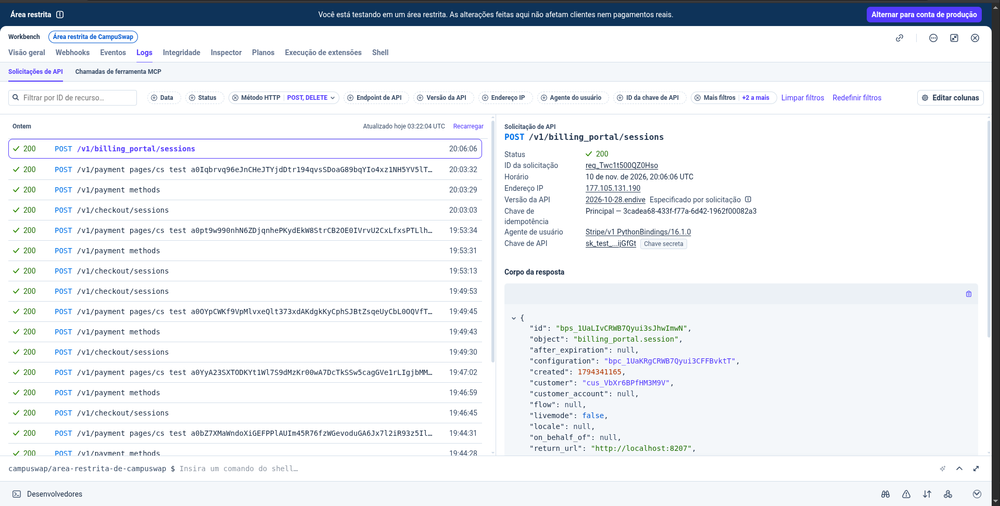
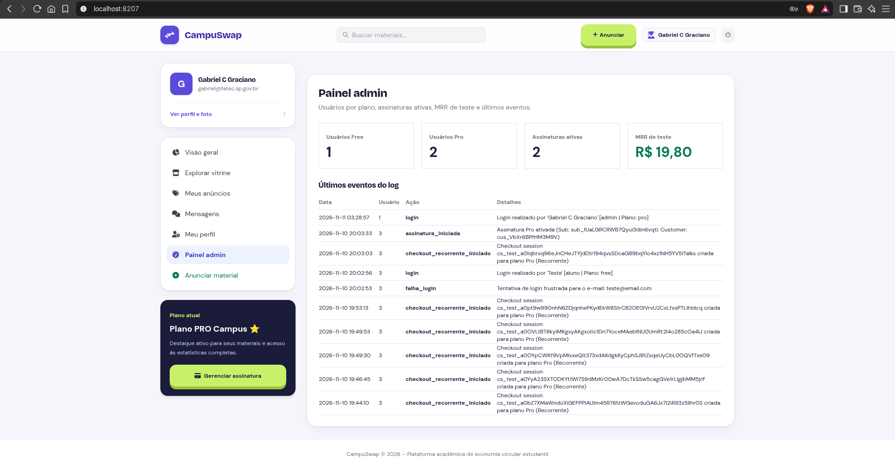

# 📚 Documentação Técnica Reversa do Sistema

Documento integrante da **Atividade 8** da disciplina de Introdução à Computação em Nuvem (ISW055), sob orientação do professor [siriani](https://github.com/siriani).

[← Voltar ao README](./README.md)

> **Relatório P2 (individual):** [docs/P2_ISW055_Gabriel_Graciano.pdf](./docs/P2_ISW055_Gabriel_Graciano.pdf) — arquitetura e atividades 7 a 11, disciplina ISW055, professor [siriani](https://github.com/siriani).

> **Alterações posteriores à entrega da P2 (12/11/2026).** O relatório P2 descreve a versão entregue em 11/11/2026 e não foi alterado. Depois dela, sem mudar a arquitetura:
> - o link do e-mail de recuperação de senha passou a usar `PUBLIC_BASE_URL` em vez de cair em `localhost` (PR #18);
> - as fotos dos anúncios ficaram persistentes: MinIO com `S3BACKEND=file` e volumes (PR #19); no relatório, o MinIO aparece em memória, como estava na entrega;
> - novo visual escuro e minimalista, com ícones de contorno e novo logotipo (PR #20); os prints do relatório mostram o visual anterior;
> - script `db/001_dominio.sql` com o esquema das tabelas (PR #14).
> - layout adaptado para smartphone (PR #23) e busca do cabeçalho exibida só para quem está logado (PR #22);
> - front separado em `catalogo_service/static/app.css` e `app.js`, com cache de 1 dia invalidado a cada deploy (PRs #24 e #27);
> - **paginação** da vitrine e de "Meus anúncios" (9 por página, com filtro e busca no servidor), **selo de destaque** e prioridade para anúncios de assinantes, e **métricas completas exclusivas do plano Premium** com dados reais; o plano Free vê um bloqueio com convite ao upgrade (PRs #25 e #26);
> - o item "Painel admin" deixou de aparecer para quem não é admin (PR #26; o backend já exigia o papel);
> - `DELETE /api/itens/{id}` e o envio de foto passaram a exigir login e ser o dono do anúncio (ou admin/moderador) (PR #25);
> - **21 testes automatizados** (pytest) no CI, rodando antes do build das imagens, e actions do `deploy.yml` atualizadas para versões com Node 24 (PR #25).

---

## 1. Especificação Funcional (O Que o Sistema Faz)

A aplicação é uma plataforma web voltada à economia circular e intercâmbio de materiais acadêmicos entre estudantes universitários (**CampuSwap**), implementada com base em uma arquitetura de microsserviços distribuídos:

- **Autenticação, perfis e papéis (RBAC):** cadastro de usuários com validação de credenciais, login com senha protegida por hash seguro (Bcrypt) e emissão de tokens assinados JWT (PyJWT). Suporte a controle de acesso baseado em papéis (`aluno` e `admin`). Inclui fluxo de recuperação e redefinição de senha via SMTP (Mailtrap).
- **Catálogo e vitrine de materiais:** anúncio, listagem, busca e filtragem de materiais acadêmicos por tipo de transação (`doação`, `troca` ou `venda`). Os dados dos anúncios e materiais ficam persistidos de forma relacional no MariaDB.
- **Controle de propriedade e integridade de registros:** cada anúncio pertence estritamente ao estudante que o cadastrou. Somente o criador do anúncio ou usuários com papel administrativo (`admin`) têm autorização para editar ou remover o registro cadastrado. Tentativas de exclusão de anúncios alheios por estudantes comuns são rejeitadas com erro `403 Forbidden`.
- **Monetização e Plano PRO Campus:** integração com checkout do Stripe em modo de teste para assinatura do plano Premium universitário. Após o pagamento e o processamento de webhooks, o perfil ganha o badge de destaque na vitrine e acesso a relatórios avançados.
- **Armazenamento de objetos (fotos dos materiais):** integração com MinIO (API compatível com Amazon S3) em bucket privado (`campuswap-fotos`). O envio e consumo de fotos dos materiais acadêmicos é mediado e controlado pelo `catalogo_service`.
- **Auditoria, segurança e mensageria:** eventos sensíveis (logins, falhas de autenticação, publicação de anúncios, alterações e bloqueios por tentativa de acesso negado 403) são emitidos em tempo real para o `log_service`, que os consolida e indexa em fluxos do Redis Streams. A extração dos registros consolidados é restrita a administradores.
- **Observabilidade:** readiness probe e liveness probe implementados nos endpoints `/health` de cada serviço, além de métricas exportadas para Prometheus no endpoint `/metrics`.

---

## 2. Tecnologias Utilizadas

| Camada | Tecnologia |
|---|---|
| Serviços de back-end | Python 3.11, FastAPI, Pydantic, Uvicorn |
| Autenticação e RBAC | Bcrypt (hashing), PyJWT (HS256) |
| Banco de dados relacional | MariaDB 10.11 |
| Logs de auditoria e cache | Redis 7 (Redis Streams) |
| Armazenamento de objetos | MinIO (armazenamento compatível com S3) |
| E-mail transacional | SMTP sandbox (Mailtrap) |
| Pagamentos e assinaturas | Stripe API & Webhooks (modo de teste) |
| Orquestração e deploy | Docker Compose, Portainer |
| Métricas e monitoramento | `prometheus-fastapi-instrumentator` |
| Infraestrutura | Ambiente gerenciado / VM em nuvem (`lapps.studio`) |
| Front-end | SPA responsiva (HTML5, Tailwind CSS, JavaScript nativo) |

---

## 3. Arquitetura do Sistema

O diagrama abaixo descreve o isolamento de rede, a comunicação entre contêineres e a integração com serviços externos. Apenas o `catalogo_service` e as portas mapeadas de aplicação ficam expostos publicamente. Os demais serviços comunicam-se de forma isolada na sub-rede `tom_hanks_net`.



> **Classificação das Camadas de Nuvem:**
> - **IaaS:** A infraestrutura de computação, processamento e conectividade de rede da VM base Linux/Proxmox.
> - **PaaS:** A orquestração dos serviços via contêineres Docker gerenciados pelo Portainer na sub-rede `tom_hanks_net`.
> - **SaaS:** Dependências terceiras consumidas por API ou protocolo padrão (Stripe para processamento de pagamentos e Mailtrap para gateway sandbox de SMTP).

---

## 4. Catálogo de Regras de Negócio

| ID | Regra | Comportamento e Resultado |
|---|---|---|
| **RN01** | **Autenticação e Assinatura JWT** | Requisições a rotas protegidas exigem token Bearer válido no cabeçalho `Authorization`. Token expirado ou assinatura inválida retorna HTTP `401 Unauthorized`. |
| **RN02** | **Controle de Acesso por Papel (RBAC)** | Endpoints administrativos (como `/api/admin/estatisticas` e leitura de logs) exigem a claim de papel `admin`. Papéis de menor privilégio (como `aluno`) recebem HTTP `403 Forbidden` (`{"detail": "Acesso negado: o papel 'aluno' não possui permissão para esta operação."}`). |
| **RN03** | **Bloqueio de Modificação de Registro Alheio** | Apenas o autor do anúncio (`material.usuario_id == token.usuario_id`) ou um `admin` pode alterar ou remover um material. Caso outro usuário autenticado tente a exclusão, a API retorna HTTP `403 Forbidden` (`{"detail": "Acesso não autorizado: não pode remover anúncios de outros utilizadores."}`). |
| **RN04** | **Classificação de Transações Acadêmicas** | Todo material registrado deve pertencer obrigatoriamente a uma das três categorias: `doacao` (preço fixado em zero/grátis), `troca` ou `venda` (preço numérico positivo). |
| **RN05** | **Isolamento de Armazenamento de Fotos no MinIO** | Imagens enviadas para itens são salvas exclusivamente no bucket `campuswap-fotos`. O bucket possui restrição de acesso público direto (HTTP 403), sendo servido ou gerenciado via credenciais da aplicação. |
| **RN06** | **Ativação do Plano PRO Campus** | Ao receber a notificação de checkout concluído da Stripe via webhook, o status de assinatura (`is_premium`) do usuário é atualizado, concedendo destaque visual na vitrine e novos privilégios na emissão de tokens. |
| **RN07** | **Trilha de Auditoria Obrigatória** | Qualquer tentativa de escalada de privilégio, violação de posse (403) ou modificação de dados gera obrigatoriamente um evento de log encaminhado ao `log_service`. |

---

## 5. Modelagem de Dados

A persistência relacional reside no MariaDB (`campuswap_db`), enquanto as imagens binárias são tratadas pelo MinIO e as trilhas de auditoria ficam desacopladas no Redis Streams.



### Relacionamentos e Isolamento

- **USUARIOS → MATERIAIS (1:N):** um estudante cadastra diversos anúncios de livros, apostilas ou equipamentos. A chave estrangeira `usuario_id` garante a validação estrita de posse e a trava de segurança na deleção/atualização (RN03).
- **MATERIAIS → MinIO (1:1 lógico):** o banco armazena unicamente o identificador e caminho relativo da imagem (`foto_url`). O binário reside de forma persistente no volume `gabriel_minio_data`.
- **Auditoria desacoplada:** os eventos de auditoria são mantidos em memória no Redis com retenção configurável, evitando concorrência e degradação de performance na base relacional MariaDB.

---

## 6. Observabilidade e Monitoramento

| Serviço | Healthcheck (`/health`) | Coleta de Métricas (`/metrics`) |
|---|---|---|
| `catalogo_service` | Verifica integridade da conexão ao MariaDB (`200 OK` / `503 Service Unavailable`) | Prometheus instrumented via FastAPI |
| `auth_service` | Verifica prontidão do MariaDB e validação interna (`200 OK`) | Prometheus instrumented via FastAPI |
| `log_service` | Verifica comunicação ativa com o Redis Streams via ping (`200 OK`) | Prometheus instrumented via FastAPI |

Cada serviço possui healthcheck configurado no Docker Compose rodando em intervalos de 10 segundos com tolerância a falhas transitórias (`retries: 3`, `start_period: 15-25s`).

---

## 7. Como Executar

```bash
# 1. Clonar o repositório
git clone https://github.com/Gabriel33-fis/campuswap.git
cd campuswap

# 2. Configurar o arquivo de variáveis de ambiente
cp .env.example .env
# Configure suas credenciais de banco, segredos JWT e chaves de teste da Stripe

# 3. Subir toda a pilha de microsserviços
docker compose up -d --build
```

A aplicação publica a porta `8207` (mapeada para a porta interna `8000` do `catalogo_service`) e a porta `5000` para o `auth_service`. Em ambiente de produção gerenciado (Portainer), a stack é orquestrada diretamente com persistência nos volumes `gabriel_mariadb_data` e `gabriel_minio_data`.

---

## 8. Principais Endpoints

| Módulo | Método | Rota | Descrição |
|---|:---:|---|---|
| **Autenticação** | `POST` | `/api/auth/register` | Criação de conta institucional |
| | `POST` | `/api/auth/login` | Autenticação e emissão do Bearer JWT |
| | `POST` | `/api/auth/forgot-password` | Solicitação de recuperação de senha por e-mail |
| | `POST` | `/api/auth/reset-password` | Validação de token e redefinição de credencial |
| **Materiais** | `GET` | `/api/materiais` ou `/api/itens` | Listagem pública da vitrine acadêmica |
| | `POST` | `/api/materiais` | Cadastro de novo material (requer autenticação) |
| | `DELETE` | `/api/itens/{id}` ou `/api/materiais/{id}` | Exclusão restrita ao dono do registro ou `admin` |
| **Administração** | `GET` | `/api/admin/estatisticas` | Métricas gerais restritas ao perfil `admin` |
| | `GET` | `/api/admin/logs` | Consulta a eventos de auditoria gravados no Redis Streams |
| **Health** | `GET` | `/health` | Verificação de status nos microsserviços |

---

## 9. Evidências de Validação e Implantação

As evidências fotográficas da stack em execução e dos testes de segurança encontram-se organizadas no diretório [`docs/prints/`](./docs/prints/):

1. **`01-landing.png`**: Interface pública do CampuSwap acessível via proxy reverso com domínio seguro.
2. **`02-listagem.png`**: Vitrine de materiais com filtros de transação (`doação`, `troca`, `venda`) e usuário autenticado.
3. **`03-403-papel.png`**: Bloqueio de autorização RBAC (`HTTP 403 Forbidden`) para perfil `aluno` em endpoint administrativo.
4. **`04-bloqueio-registro.png`**: Bloqueio de segurança (`HTTP 403 Forbidden`) na tentativa de exclusão de material de outro usuário.
5. **`05-eventos-log.png`**: Logs do serviço `gabriel_log_service` processando eventos e respondendo a healthchecks.
6. **`06-minio.png`**: Conexão com a API do MinIO confirmando o bucket `campuswap-fotos` e controle de permissões S3.
7. **`07-portainer.png`**: Painel do Portainer demonstrando todos os contêineres da stack ativos e saudáveis (`healthy`/`running`).

---

## Atividade 11 — SaaS completo com Stripe

Entrega da **Atividade 11** (ISW055 — Introdução à Computação em Nuvem), sob orientação do professor @siriani.

O Plano Premium, que antes era uma cobrança única, virou uma **assinatura recorrente mensal** no Stripe, sempre em **modo de teste** (nenhuma cobrança real).

### Planos e limites

| Plano | Preço | Limite de anúncios |
|---|---|---|
| Free | R$ 0,00 | 3 anúncios por mês |
| Pro | R$ 9,90/mês | Sem limite |

O limite é aplicado **no backend** (`POST /api/itens`). Ao estourar, a API responde `402` com a mensagem: *"Limite do plano Free atingido: 3 anúncios por mês (3/3 usados). Assine o plano Pro para anunciar sem limite."* O valor do limite é configurável por `LIMITE_FREE_ANUNCIOS`.

### Como funciona

- **Checkout de assinatura:** `POST /api/checkout` cria uma Checkout Session com `mode=subscription`, ligada a um customer do Stripe guardado no usuário (`stripe_customer_id`). Dados de cartão nunca passam pelo servidor.
- **Webhook:** `POST /api/assinaturas/webhook` valida a assinatura de cada evento (`Stripe-Signature`) e trata `checkout.session.completed`, `customer.subscription.updated`, `customer.subscription.deleted` e `invoice.payment_failed`. O plano só muda quando o webhook chega e é validado, e não quando o navegador volta do checkout.
- **Idempotência:** cada `event.id` é gravado na tabela `eventos_stripe`; um evento repetido responde `duplicate` e não produz efeito duplicado.
- **Portal do cliente:** o botão "Gerenciar assinatura" abre o Billing Portal do Stripe, com cancelamento imediato habilitado para teste.
- **Painel admin:** acessível apenas ao papel `admin`. Mostra usuários por plano, assinaturas ativas, MRR de teste (soma do valor mensal das assinaturas ativas) e os últimos eventos do log (`GET /api/admin/metricas`).

### Variáveis de ambiente

A chave secreta e o segredo do webhook ficam **somente em variáveis de ambiente**, nunca no código. Veja o `.env.example` (apenas nomes, sem valores): `STRIPE_SECRET_KEY`, `STRIPE_PRICE_ID`, `STRIPE_WEBHOOK_SECRET`, `FRONTEND_URL`, `CHECKOUT_SUCCESS_URL`, `CHECKOUT_CANCEL_URL`, `LIMITE_FREE_ANUNCIOS`.

### Como executar e testar (ambiente local)

A execução desta entrega foi feita **localmente com Docker Compose**; o deploy no Portainer não foi concluído.

```bash
cp .env.example .env        # preencha com as chaves de TESTE do Stripe
docker compose up -d --build
stripe listen --events checkout.session.completed,customer.subscription.updated,customer.subscription.deleted,invoice.payment_failed \
  --forward-to localhost:5000/api/assinaturas/webhook
```

Roteiro de teste: criar conta (nasce no Free), usar até estourar o limite, assinar o Pro com o cartão `4242 4242 4242 4242` (qualquer data futura e qualquer CVC), confirmar que o plano virou Pro após o webhook, cancelar pelo portal e entrar como admin para conferir o painel.

### Evidências

| Evidência | Print |
|---|---|
| Limite bloqueando no plano Free |  |
| Assinatura com o cartão 4242 |  |
| Plano Pro ativo no sistema |  |
| Assinatura no dashboard do Stripe (modo de teste) |  |
| Evento `checkout.session.completed` no Stripe |  |
| Evento processado e registrado no banco |  |
| Portal do cliente (Billing Portal) |  |
| Painel admin |  |
