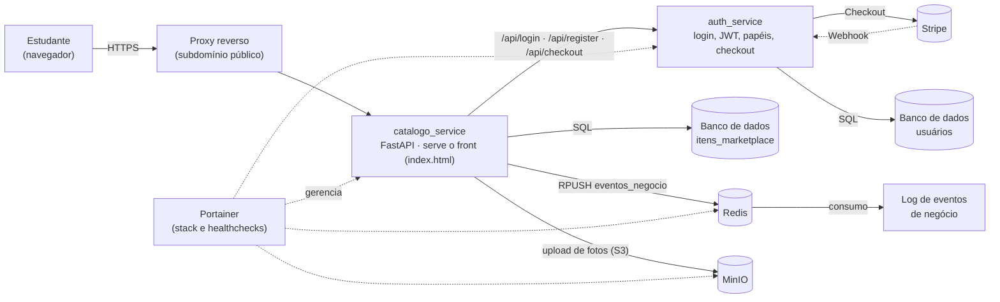
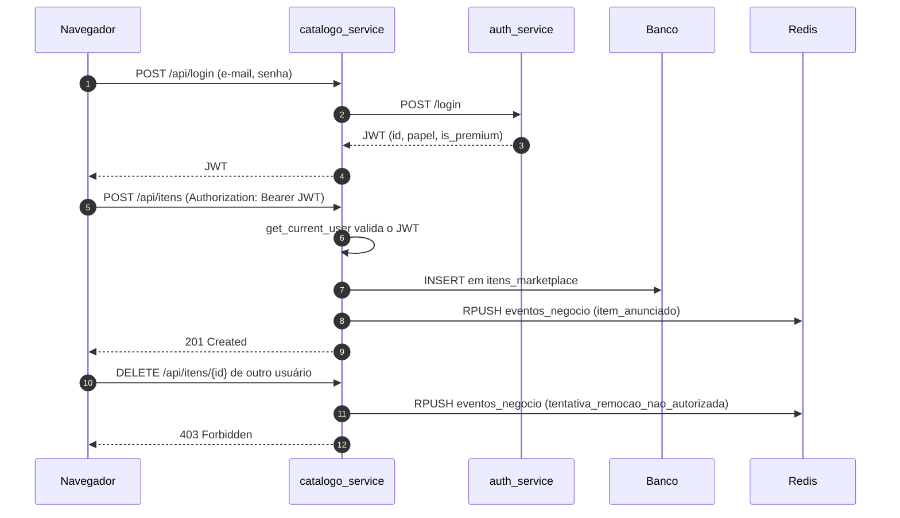
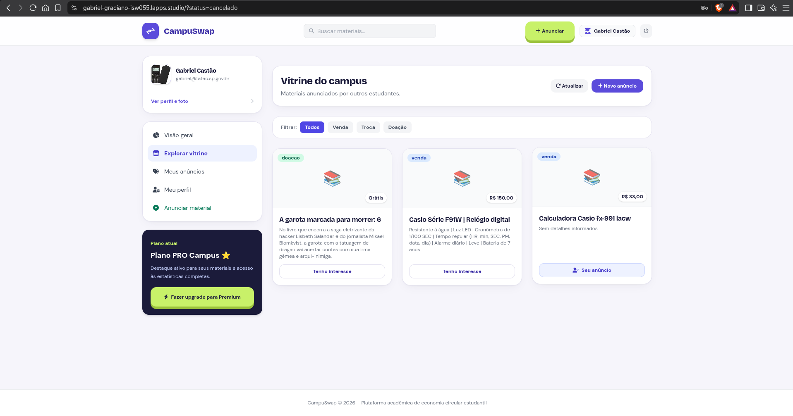
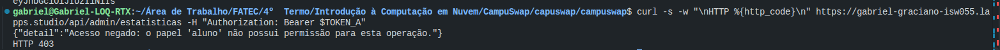
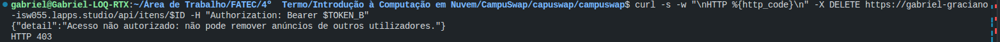
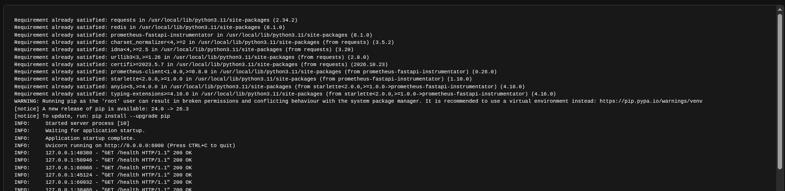
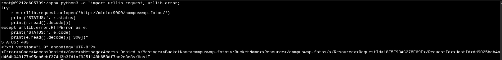
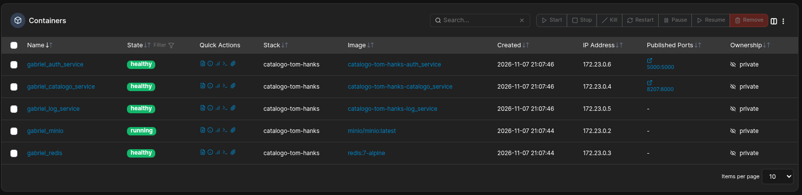

# 📦 CampuSwap — Seu marketplace no campus

Atividade desenvolvida para a disciplina de Introdução à Computação em Nuvem (ISW055), sob orientação do professor [siriani](https://github.com/siriani).

> **🌐 Sistema no ar:** **[https://SEU-SUBDOMINIO.exemplo.com.br](https://SEU-SUBDOMINIO.exemplo.com.br)**
> **📚 Documentação da API (Swagger):** `https://gabriel-graciano-isw055.lapps.studio/docs`
> **🧾 Issue de entrega:** ["Entrega — Seu negócio no ar"](https://github.com/Gabriel33-fis/campuswap/issues/

---

## Sumário

1. [Nome e Frase](#1-nome-e-frase)
2. [A Dor](#2-a-dor)
3. [Persona](#3-persona)
4. [Concorrentes e Alternativas](#4-concorrentes-e-alternativas)
5. [Proposta de Valor](#5-proposta-de-valor)
6. [Modelo de Receita com Stripe](#6-modelo-de-receita-com-stripe)
7. [Métricas de Sucesso](#7-métricas-de-sucesso)
8. [Lean Canvas](#8-lean-canvas)
9. [Arquitetura](#9-arquitetura)
10. [Papéis e permissões](#10-papéis-e-permissões)
11. [Eventos de negócio](#11-eventos-de-negócio)
12. [Banco de dados: migração e seed](#12-banco-de-dados-migração-e-seed)
13. [Como executar](#13-como-executar)
14. [Evidências da entrega](#14-evidências-da-entrega)
15. [Mapa de Reaproveitamento Arquitetural](#15-mapa-de-reaproveitamento-arquitetural)

---

## 1. Nome e Frase
**CampuSwap**: O marketplace universitário para compra, venda, empréstimo e troca de livros, calculadoras e materiais acadêmicos essenciais dentro do próprio campus.

---

## 2. A Dor
Estudantes universitários enfrentam custos elevados semestrais com livros didáticos, calculadoras científicas, jalecos e materiais técnicos que frequentemente são utilizados por apenas um semestre ou disciplina específica. Ao mesmo tempo, veteranos acumulam esses materiais parados em repúblicas e quartos sem um canal confiável e rápido para repassá-los. As alternativas atuais (grupos de WhatsApp desorganizados ou marketplaces genéricos) geram desconfiança, golpes, custos de frete inviáveis e desencontros geográficos.

---

## 3. Persona
* **Nome Fictício:** Lucas Ferreira, 21 anos.
* **Perfil:** Estudante do 3º semestre de Engenharia/Tecnologia na Fatec.
* **Rotina e Desafio:** Lucas tem orçamento mensal restrito e precisa de um livro de Cálculo e de uma calculadora gráfica para a matéria do semestre atual. Uma calculadora nova custa mais de R$ 250,00 na loja. Ele tenta garimpar ofertas no grupo de calouros/veteranos no WhatsApp, mas as mensagens se perdem em conversas paralelas e ele não sabe se o vendedor realmente estuda na faculdade ou se o produto está em bom estado.

---

## 4. Concorrentes e Alternativas

1. **Grupos de WhatsApp / Telegram de Turma:**
   * *O que faz mal:* Totalmente desestruturado; anúncios somem no feed de conversas, não há histórico de preços, não há busca por categoria e inexiste controle de itens já vendidos ou emprestados.
2. **Mercado Livre / Enjoei / OLX:**
   * *O que faz mal:* O valor do frete muitas vezes supera o preço do livro usado; transações distantes sem pontos de encontro práticos no campus e sem validação de vínculo universitário.
3. **Murais Físicos e Boca a Boca no Campus:**
   * *O que faz mal:* Alcance extremamente restrito, falta de fotos detalhadas dos itens e lentidão para fechar negociações.

---

## 5. Proposta de Valor
O CampuSwap transforma a comunidade acadêmica em uma rede prática e confiável de economia circular, viabilizando transações presenciais seguras dentro da faculdade e com custo zero de entrega.

Na página inicial do sistema, a proposta é apresentada em três ideias:

* **Pague menos pelo que precisa:** livros e calculadoras de colegas que já cursaram a disciplina.
* **Transforme o que sobrou em dinheiro:** anuncie para venda, troca, empréstimo ou doação.
* **Entrega no corredor do campus:** todo anunciante é estudante verificado, sem frete e sem espera.

A landing page também traz uma calculadora com controle deslizante que estima a economia por semestre (estimativa de R$ 90 por material, com 60% de economia na compra e 40% de retorno na venda).

---

## 6. Modelo de Receita com Stripe

O CampuSwap opera em modelo **Freemium** monetizado via **Stripe**:

* **Plano Gratuito (Free Tier):**
  * Até 3 anúncios ativos simultaneamente.
  * Modos de negociação básicos: Venda direta e Empréstimo simples.
  * Busca local com raio padrão de entrega no campus.
* **Plano Estudante Pro (Assinatura Stripe — R$ 6,90 / mês):**
  * Anúncios ilimitados simultâneos (ideal para veteranos e formandos repassando múltiplos itens).
  * Destaque visual dos anúncios na página inicial do catálogo.
  * Acesso liberado às modalidades de **Troca Direta (Swap)** e alertas de busca prioritária para livros concorridos.

---

## 7. Métricas de Sucesso
* **Aquisição:** Número de cadastros de estudantes verificados por mês.
* **Ativação:** Volume de anúncios de livros e materiais publicados semanalmente.
* **Receita (MRR):** Receita Recorrente Mensal gerada a partir das assinaturas do Plano Pro via Stripe.
* **Retenção / Liquidez:** Percentual de itens marcados como vendidos/emprestados em até 14 dias após a publicação.

---

## 8. Lean Canvas

| Bloco | Resposta do CampuSwap |
| :--- | :--- |
| **Problema** | 1. Alto custo de materiais acadêmicos pontuais. <br>2. Materiais úteis parados com veteranos. <br>3. Insegurança e desorganização nos grupos de WhatsApp. |
| **Segmentos de Clientes** | Universitários da Fatec e campi regionais (graduandos buscando economia e formandos querendo desapegar de materiais). |
| **Proposta Única de Valor** | Compartilhe mais, compre menos: o marketplace acadêmico confiável de troca, empréstimo e compra no seu campus. |
| **Solução** | 1. Catálogo estruturado de itens acadêmicos (livros, calculadoras, apostilas). <br>2. 4 modos de transação: Comprar, Vender, Emprestar e Trocar. <br>3. Perfis autenticados com foto e pontos de encontro no campus. |
| **Canais** | Divulgação em semanas acadêmicas, centros acadêmicos (CAs), atléticas, cartazes nos murais do campus e grupos institucionais. |
| **Fontes de Receita** | Assinatura mensal do Plano Estudante Pro (R$ 6,90/mês) processada via Stripe Checkout e Webhooks. |
| **Estrutura de Custos** | Servidor virtual (IaaS Proxmox), custos transacionais/taxas do Stripe e taxa de domínio/registro. |
| **Métricas-Chave** | Cadastros mensais, anúncios criados, taxa de conversão Free → Pro e MRR. |
| **Vantagem Injusta** | Base local fechada no campus (confiança entre pares), proximidade física imediata eliminando frete e validação acadêmica. |

---

## 9. Arquitetura

### 9.1 Visão geral dos serviços



> Ajuste os nomes dos containers e dos bancos para os que aparecem no seu `docker-compose.yml` / stack do Portainer.

### 9.2 Serviços

| Serviço | Responsabilidade | Conversa com |
| :--- | :--- | :--- |
| **catalogo_service** (FastAPI) | Catálogo de materiais, CRUD com isolamento por usuário, moderação, estatísticas de admin, upload de fotos, entrega do front-end | auth_service, banco, Redis, MinIO |
| **auth_service** | Cadastro, login, emissão do JWT com o papel do usuário e checkout do Plano Pro | Stripe, banco de usuários |
| **Redis** | Fila de eventos de negócio (lista `eventos_negocio`) para auditoria | catalogo_service, log de eventos |
| **MinIO** | Armazenamento S3 das fotos de produtos e de perfil | catalogo_service |
| **Stripe** | Cobrança recorrente do Plano Estudante Pro | auth_service |
| **Portainer** | Deploy da stack e monitoramento de saúde dos containers | todos os containers |

### 9.3 Como os serviços conversam



### 9.4 Endpoints principais

| Método e rota | Quem acessa | Descrição |
| :--- | :--- | :--- |
| `GET /health` | público | Verificação de saúde (usada nos healthchecks) |
| `POST /api/register`, `POST /api/login` | público | Proxy para o auth_service |
| `POST /api/checkout` | autenticado | Cria a sessão de pagamento do Plano Pro na Stripe |
| `GET /api/itens`, `GET /api/itens/{id}` | público | Vitrine de materiais disponíveis |
| `GET /api/meus-itens` | autenticado | Apenas os anúncios do próprio usuário |
| `POST /api/itens` | autenticado | Cria anúncio (o dono vem do JWT, nunca do corpo) |
| `PUT /api/itens/{id}` | dono, moderador ou admin | Edita anúncio. Outros usuários recebem **403** |
| `DELETE /api/itens/{id}` | dono, moderador ou admin | Remove anúncio. Outros usuários recebem **403** |
| `POST /api/itens/{id}/foto` | dono, moderador ou admin | Envia a foto do item para o MinIO |
| `PATCH /api/itens/{id}/moderar` | moderador ou admin | Aprova ou suspende um anúncio |
| `GET /api/admin/estatisticas` | admin | Totais de itens por status |

---

## 10. Papéis e permissões

O papel do usuário vem no JWT emitido pelo `auth_service`. O `catalogo_service` aplica as regras em cada rota.

| Papel | O que pode fazer |
| :--- | :--- |
| `aluno` | Ver a vitrine, anunciar, editar e remover **apenas os próprios** anúncios |
| `moderador` | Tudo do aluno, mais editar/remover anúncios de terceiros e usar `/moderar` |
| `admin` | Tudo do moderador, mais `/api/admin/estatisticas` |

O plano **Pro** é um atributo da assinatura (`is_premium`), independente do papel.

**Regras de segurança implementadas:**

* **Isolamento por usuário:** o `usuario_id` do anúncio é comparado ao id do JWT. Se forem diferentes e o papel não for `moderador` ou `admin`, a API responde `403 Forbidden`.
* **Controle por papel:** rotas administrativas usam a dependência `verificar_papeis([...])`. Um `aluno` que chama `/moderar` ou `/admin/estatisticas` (por curl, Postman ou Swagger) recebe `403`.
* **Dono vindo do token:** ao criar um anúncio, o dono é sempre o usuário autenticado. O `PUT` ignora campos como `usuario_id`.
* **Tentativas negadas são auditadas** como eventos de negócio (seção seguinte).

---

## 11. Eventos de negócio

Cada ação relevante grava um evento JSON na lista `eventos_negocio` do Redis, no formato `{"acao", "usuario_id", "detalhes"}`.

| Evento | Quando acontece |
| :--- | :--- |
| `item_anunciado` | Um anúncio é criado |
| `item_editado` | Um anúncio é alterado |
| `item_removido` | Um anúncio é excluído |
| `item_moderado` | Um moderador aprova ou suspende um anúncio |
| `foto_item_enviada` | Uma foto é enviada ao MinIO |
| `tentativa_edicao_nao_autorizada` | Alguém tenta editar o anúncio de outro usuário |
| `tentativa_remocao_nao_autorizada` | Alguém tenta remover o anúncio de outro usuário |
| `tentativa_upload_nao_autorizada` | Alguém tenta enviar foto para o anúncio de outro usuário |

Para consultar os eventos:

```bash
docker exec -it <container-redis> redis-cli LRANGE eventos_negocio 0 -1
```

---

## 12. Banco de dados: migração e seed

Os scripts ficam versionados neste repositório:

```
db/
├── migrations/
│   └── 001_schema.sql     # criação das tabelas e colunas
└── seed.sql               # dados iniciais (usuários de teste e anúncios de exemplo)
```

**[PREENCHER]** Execute na ordem abaixo (ajuste o comando ao seu banco):

```bash
# 1) migração
<comando para executar db/migrations/001_schema.sql>
# 2) seed
<comando para executar db/seed.sql>
```

A tabela principal é `itens_marketplace`, com as colunas: `id`, `usuario_id`, `categoria_id`, `titulo`, `descricao`, `condicao`, `modalidade`, `preco`, `imagem_url`, `foto_key`, `status` e `criado_em`. Na inicialização, o `catalogo_service` também garante que as colunas `condicao`, `imagem_url` e `foto_key` existam.

**Usuários do seed (apenas para demonstração):**

| E-mail | Papel | Senha |
| :--- | :--- | :--- |
| **[PREENCHER]** | `aluno` | **[PREENCHER]** |
| **[PREENCHER]** | `aluno` (segundo usuário, para testar o isolamento) | **[PREENCHER]** |
| **[PREENCHER]** | `admin` | **[PREENCHER]** |

---

## 13. Como executar

**Pré-requisitos:** Docker e Docker Compose.

```bash
git clone https://github.com/Gabriel33-fis/campuswap
cd SEU-REPOSITORIO
cp .env.example .env        # preencha as variáveis
docker compose up -d --build
```

**Variáveis de ambiente do catalogo_service:**

| Variável | Padrão | Uso |
| :--- | :--- | :--- |
| `AUTH_SERVICE_URL` | `http://auth_service:5000` | Endereço do serviço de autenticação |
| `REDIS_HOST` | `redis` | Host do Redis |
| `REDIS_PORT` | `6379` | Porta do Redis |
| **[PREENCHER]** | | Credenciais do MinIO, chaves da Stripe e segredo do JWT |

> Nunca versione o arquivo `.env`. Mantenha apenas o `.env.example` sem valores reais.

**Deploy em produção:** a stack é publicada pelo Portainer a partir do `docker-compose.yml` e fica acessível no subdomínio informado no topo deste README.

---

## 14. Evidências da entrega

Prints armazenados em `docs/prints/`. A data e a hora da issue de entrega também servem de evidência da data realizada.

| # | Evidência | Arquivo |
| :-: | :--- | :--- |
| 1 | Landing page no ar, com a URL visível |  |
| 2 | Listagem do recurso principal (vitrine de materiais) |  |
| 3 | `403` para um papel sem permissão (aluno chamando rota de moderador ou admin) |  |
| 4 | Bloqueio ao tentar abrir/alterar o registro de outro usuário (`403`) |  |
| 5 | Eventos de negócio no log |  |
| 6 | Arquivo armazenado no MinIO |  |
| 7 | Stack no Portainer com os containers saudáveis |  |

---

## 15. Mapa de Reaproveitamento Arquitetural

| Peça do Projeto Atual (Tom Hanks) | O que vira no SaaS (CampuSwap) | Exemplo Prático no Novo Domínio |
| :--- | :--- | :--- |
| **Catálogo de Filmes (TMDB)** | **Catálogo de Materiais Acadêmicos** | Título do livro/item, categoria (Cálculo, Eletrônica, etc.), estado de conservação, modalidade (Venda/Troca/Empréstimo). |
| **Microsserviço de Login + RBAC** | **Gestão de Usuários e Perfis do Campus** | Papéis: `aluno` (estudante comum), `moderador` e `admin` (moderação do campus). O plano `Pro` é um atributo da assinatura. |
| **Logs e Auditoria (Redis)** | **Eventos de Marketplace** | Eventos assíncronos: `item_anunciado`, `item_editado`, `item_removido`, `item_moderado` e tentativas não autorizadas. |
| **Upload de Perfil (MinIO)** | **Fotos dos Produtos e Materiais** | Armazenamento de imagens reais dos livros/calculadoras e fotos de perfil dos estudantes no bucket S3 MinIO. |
| **Plano Premium (Stripe)** | **Assinatura Estudante Pro** | Assinatura recorrente que destrava anúncios ilimitados e destaque visual nas buscas do campus. |
| **Swagger, CI/CD e Observabilidade** | **Infraestrutura e Contratos de API** | Documentação OpenAPI unificada em `/docs` e deploy pelo Portainer. |